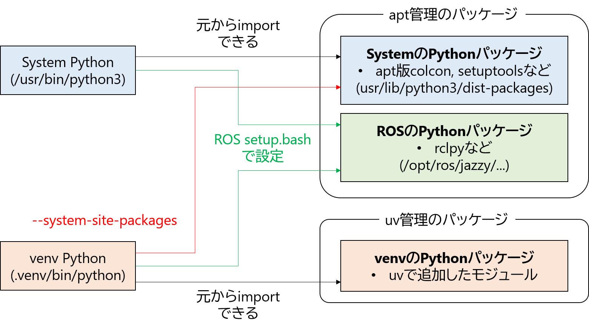
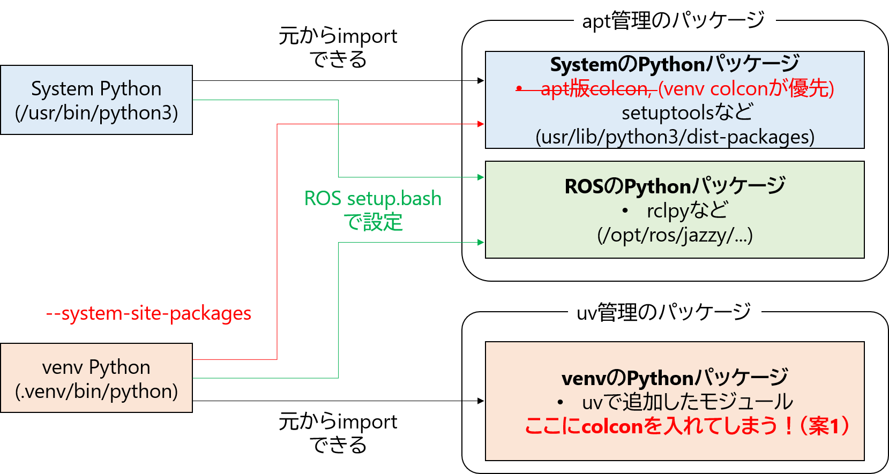

# ROS 2のuv (venv) 対応

## 背景
- apt版ROS 2を使用しながら，Pythonモジュールをuv (venv) で管理したい．（pyproject.tomlはros2_ws直下に置く想定）

【想定するPythonの関係図】



## 課題

<!-- - venvをactivateしたシェルでも，colcon buildがsystem Pythonで動いてしまう
- そのPythonがament_pythonのROSパッケージのビルドにも使用されてしまい，生成される起動スクリプトのシバンがsystem Pythonになってしまう -->
- **venvをactivateしたシェルでros2 run等しても，ament_python ROSパッケージからビルドされたノードの実行にはsystem Pythonが使われてしまい，venv内のモジュールを読み込めない**

【上記が発生するプロセス】
1. `activate` で，コマンドの検索先である `PATH` の先頭に `.venv/bin` が追加
2. colcon build時に，`.venv/bin/colcon` がなければ `/usr/bin/colcon` に解決される．このファイルのシバンが `#!/usr/bin/python3` になっている
3. colconは自分を実行しているPython（`sys.executable`）でament_pythonパッケージの `setup.py` を起動する．setuptoolsがノードの起動スクリプトを生成するが、**そのシバンは現在実行されているPythonのパスで記録される**
5. `ros2 run` などから生成スクリプトを起動すると、そのシバンに従ってsystem Pythonが動いてしまう

## 解決案1：venvにcolconを入れる

- venvにcolconを入れてしまえば，プロセス2においてcolconコマンドが`.venv/bin/colcon`で解決され，venvで実行される！

```shell
uv add colcon-common-extensions
```



### 結果

- Jazzy・Lyrical・Rollingの最小ament_python構成で，通常install・symlink-installともに成功．検証した範囲では問題なし．
<!-- [手元での検証コマンド](#テスト環境) の `venv-colcon` がこの案に対応する． -->

### 懸念点
- 一応，colconはapt環境においてはなるべくaptのcolconを使ってねと言っている
> On platforms which support Debian packages using those is preferred since they will be updated using apt together with other system packages.

https://colcon.readthedocs.io/en/released/user/installation.html

### 解決案2：colconを明示的にvenvで呼び出す

colcon buildの際は先頭に`.venv/bin/python -m`をつけるようにする

```shell
.venv/bin/python -m colcon build --symlink-install
```

### 結果

- Jazzy・Lyrical・Rollingの最小ament_python構成で，通常install・symlink-installともに成功．検証した範囲では問題なし．
<!-- [手元での検証コマンド](#テスト環境) の `apt-colcon` がこの案に対応する． -->

### 懸念点
- 毎回打つのがめんどくさい（エイリアス登録すればいい話ではあるが）

## 当面の方針

- **案1**で運用してみて，問題が生じないか確認してみる

<!-- ### 解決案3：colconの実装を変える
○○（追記）

### 結果


### 懸念点 -->

## テスト環境

### 実行要件

- docker
- python3

### 導入（初回）

リポジトリ直下で，検証用のDockerイメージを作成する．

```bash
./scripts/demo.sh doctor
./scripts/demo.sh build jazzy
```

### 検証

```bash
DEMO_IMAGE=ros2-uv-demo:jazzy ./scripts/compare_venv_solutions.sh
```

案1・案2それぞれの通常install・symlink-install，計4条件がすべて `PASS` なら成功．

Lyrical・Rollingでは，導入・検証コマンド中の `jazzy` をそれぞれ `lyrical`・`rolling` に置き換える．

[検証内容・使用バージョン・結果の詳細](docs/venv-solutions.md)


<!-- ROS Japan Dev会議に向けた進捗整理（2026-10-27）。aptで導入したROS 2と、uvで管理するワークスペース単位のvenvを併用するための再現・検証リポジトリです。

**Jazzyの最小 `ament_python` 構成では、colconをvenvのPythonで実行する2つの運用により、追加実装なしでシバンの問題を回避できました。** 今後は実用的なワークスペースでの検証と運用手順の整理を進め、残る問題を基に貢献内容を検討します。

## 背景

ROS 2をaptで導入しつつ、アプリケーションに必要なPythonの追加依存を、ワークスペースごとにuvで管理したいと考えています。ROS本体やOSのパッケージはaptで管理し、プロジェクト固有の依存はvenvに導入する構成です。

[ROS Discourse](https://discourse.openrobotics.org/t/57111) での議論とROS Japan Dev会議を受け、今回は「venvをactivateしても、colconで生成したPythonノードがsystem Pythonを使う」問題に対象を絞りました。会議でいただいた「まず仕組みを理解する」「colconが使うPythonを可視化・設定できるとよいのでは」「再現できる環境を作る」という意見を基に調査しました。

## 課題

今回の `ament_python` デモでは、apt版colconだけをインストールした状態でvenvをactivateして `colcon build` を実行すると、生成されたノードのシバンが `#!/usr/bin/python3` になります。そのノードからvenvだけに導入した依存をimportできないことが、今回の問題です。通常installと `--symlink-install` の両方で再現しました。

原因は、コマンドを探す処理と、そのコマンドを実行するPythonの選択が分かれていることです。

1. `activate` は、コマンドの検索先である `PATH` の先頭に `.venv/bin` を追加します。
2. `.venv/bin/colcon` がなければ、`colcon` は `/usr/bin/colcon` に解決されます。このファイルのシバンは `#!/usr/bin/python3` です。
3. colconは自分を実行しているPython（`sys.executable`）で `setup.py` を起動します。
4. setuptoolsは `console_scripts` の定義からノードの起動スクリプトを生成し、今回の標準設定では、そのPythonのパスをシバンに記録します。
5. `ros2 run` などから生成スクリプトを起動すると、そのシバンに従ってsystem Pythonが動きます。

この処理は、[colcon-core 0.21.3のPythonビルド処理](https://github.com/colcon/colcon-core/blob/0.21.3/colcon_core/task/python/build.py)、[PyPAのconsole_scripts仕様](https://packaging.python.org/en/latest/specifications/entry-points/#use-for-scripts)、[Jazzyのros2run実装](https://github.com/ros2/ros2cli/blob/jazzy/ros2run/ros2run/api/__init__.py) と、生成物・実行ログを照合して確認しました。

`setup.py` の `probe = uv_shebang_demo.probe:main` は、「`probe` という起動スクリプトから、指定モジュールの `main()` を呼ぶ」という定義です。Pythonを選ぶのは生成されたスクリプトのシバンであり、importされる元の `probe.py` にシバンを書いても、この選択は変わりません。

## 目的

通常installと `--symlink-install` の両方で、生成されたROSノードをvenvのPythonで実行し、venv内の追加依存とapt由来の `rclpy` を併用できることを確認します。そのうえで、既存機能による運用で解決できる範囲と、colconへの追加実装が必要になる要件を整理します。

## 解決のアプローチ

両方式とも、ROSのapt環境に合わせて `/usr/bin/python3` を基にvenvを作り、`--system-site-packages` を指定します。ROSのパッケージを参照するために `/opt/ros/jazzy/setup.bash` もsourceします。

```bash
# 対象ワークスペース内でvenvを新規作成する場合
source /opt/ros/jazzy/setup.bash
uv venv --python /usr/bin/python3 --system-site-packages .venv
```

| | A：apt版colconをvenvのPythonで実行 | B：venvにcolconを導入 |
| --- | --- | --- |
| colconの配置・管理 | apt側のcolconを利用 | `uv add --dev colcon-common-extensions` でvenvへ導入 |
| ビルドコマンド | `.venv/bin/python -m colcon build --symlink-install` | activate後に `colcon build --symlink-install` |
| colconと `setup.py` を実行するPython | venvのPython | venvのPython |
| 生成されるノードのシバン | venvのPythonへの絶対パス | venvのPythonへの絶対パス |
| 運用上の利点 | apt版のビルドツールを利用できる | 普段の `colcon build` を維持し、ツールのバージョンもプロジェクトで管理できる |
| 運用上の負担 | 起動コマンドにPythonを明示する必要がある | colcon・拡張・setuptoolsの更新や依存の整合性をプロジェクト側で管理する |

Aではvenvからapt側のcolconモジュールをimportします。Bでは、`source .venv/bin/activate` 後の `colcon` が `.venv/bin/colcon` に解決され、venv側のcolconモジュールを使います。apt版をアンインストールする必要はありません。今回のAでは、venvにcolconやsetuptoolsの別バージョンを導入していません。

Bでcolconをdev依存として宣言すると、`pyproject.toml` と `uv.lock` で管理でき、通常の `uv sync` でも導入対象になります。依存宣言への追加方法は [uvのドキュメント](https://docs.astral.sh/uv/concepts/projects/dependencies/#development-dependencies) に従っています。apt側のROSやOSパッケージのバージョンは、別途管理が必要です。

両方式で得られるのは、**ビルドに使ったvenvのPythonを指す起動スクリプト**です。実行時に別のvenvをactivateしても、生成済みのシバンは切り替わりません。

## 結果

2026-10-26（JST）に、Ubuntu 24.04 / ROS 2 Jazzy / Python 3.12.3 / uv 0.11.28で比較しました。各条件は新しいワークスペースで実行し、試験用パッチは使用していません。

| 方式 | 通常install | symlink-install | setuptools |
| --- | --- | --- | --- |
| A：apt版colconをvenvのPythonで実行 | PASS | PASS | apt版 68.1.2 |
| B：venvにcolconを導入 | PASS | PASS | uvで解決した79.0.1 |

両方式のcolcon-coreは0.21.3です。4条件、計28回のノード起動で、次の動作を確認しました。

- `ros2 run` と `ros2 launch` の両方で、ノードの `sys.executable` / `sys.prefix` が対象venvを示し、venv専用依存のimportと `rclpy` によるノード生成が成功。
- venvをactivateしない実行環境でも、ROSとワークスペースのsetupをsourceすれば、ノードはシバンで指定したvenvのPythonを使用。
- symlink-installでは実際に `setup.py develop` を通り、ソース編集が再ビルドなしで反映。通常installへのフォールバックは0件。
- `uv sync --locked --offline` 後もノードが動作し、Bではvenv内のcolconのバージョン・読み込み元も維持。

比較前後でsystem Pythonのパッケージ一覧・バージョン・配置は変わっていません。バージョン、コマンド、判定条件、保存済みログの場所は [2方式の検証記録](docs/venv-solutions.md) にまとめています。

**この2方式を同じ条件で比較した範囲は、Jazzyの最小 `ament_python` パッケージです。** `ament_cmake` 混在、NumPyなどのC拡張のABI、大規模な依存構成、他ディストリビューションでのBの動作、環境の移設は未検証です。別途、Aと試験用パッチを含む既存デモには [2026-09-29の3ディストリビューション・42条件の検証記録](docs/validation.md) があります。

## 結論と会議で相談したいこと

今回のシバン問題は、検証した構成では既存機能で回避できました。日常のコマンドを `colcon build` に保てるBを、ワークスペース単位のuv運用の第一候補と考えています。apt側のビルドツールを使いたい場合にはAを選べます。[colconの公式導入手順](https://colcon.readthedocs.io/en/released/user/installation.html) はaptとvenvへのpip導入の両方を説明し、Debian系ではaptによる更新管理を推奨しています。Bの採用時には、プロジェクト側でツールの互換性を確認する運用が必要です。

「colconが使うPythonの可視化」という提案は、今回の原因の把握に直結していました。検証環境では、colconのコマンド位置・シバン、ビルド時のPythonとモジュールの読み込み元、生成されたノードのシバン、実行時のPythonを記録しています。一方、Pythonを指定する新たな設定機能は、今回の2方式で満たせない要件を明確にしてから検討したいと考えています。

会議では、次の進め方について相談したいと考えています。

1. Bを中心に、uvとapt版ROSを併用する手順・注意点を整理し、ドキュメントや再現例として貢献する。
2. `ament_cmake` を含む実用的な構成や他ディストリビューションへ検証を広げ、互換性と運用上の負担を確認する。
3. その結果を踏まえ、Python選択の診断表示や設定機能として何が不足しているかを議論する。

なお、既存の試験用パッチは「生成シバンを `#!/usr/bin/env python3` にして、実行時の `PATH` からPythonを選ぶ」という別の要件を検証するものです。A・Bによる解決には使っていません。`--python-shebang env` は、このリポジトリだけの試験用オプションです。

## Pythonの関係図

### 1. Python環境とパッケージの参照関係

図の矢印は、各Python環境からパッケージを参照できる関係を表します。venvはsystem Pythonを基に作成し、venv固有のパッケージ置き場を持ちます。`--system-site-packages` を付けると、system側のパッケージも参照できます。この設定だけでsystem側からvenv内のパッケージが見えるようにはなりません。[Pythonのvenv仕様](https://docs.python.org/3.12/library/venv.html#how-venvs-work)



ROSの `/opt/ros/...` の参照先は、ROSのsetupをsourceして設定します。`--system-site-packages` だけでROSの環境設定まで済むわけではありません。venv側とsystem側に同名のパッケージがある場合、通常はvenv側のsite-packagesが先に検索されますが、ROSのsetupによる `PYTHONPATH` なども `sys.path` に影響します。

`PATH` は実行するコマンドを探す一覧、`sys.path` はPythonのimport先を探す一覧です。colconの起動ファイルの選択と、colconモジュールの読み込み元は、それぞれ確認します。

[図のPNG](docs/figures/python-environments.png) / [編集用Mermaid](docs/figures/python-environments.mmd)

### 2. colconの起動からノード実行まで

各列の上から下へ、colconの起動、ビルドに使うPython、生成物のシバン、ノードの実行を示します。問題が起こる構成とBでは、venvをactivateしてから `colcon build` を実行しています。`/ws` はワークスペースの絶対パスの例です。



`ros2 run` 自身を実行するPythonと、子プロセスであるノードのPythonは別々に決まります。この検証では、apt側のROS CLIからvenvのPythonで動くノードを起動できました。

`ament_cmake` で自作スクリプトを単純に `install(PROGRAMS ...)` する場合は、そのファイルのシバンを使います。`ament_python` の `console_scripts` では、setuptoolsが生成する起動スクリプトのシバンを使います。どちらも最終的に `main()` を呼ぶ構成にできますが、起動用コードとシバンを誰が用意するかが異なります。[CMakeのinstall仕様](https://cmake.org/cmake/help/latest/command/install.html#installing-files)

[図のPNG](docs/figures/colcon-python-flow.png) / [編集用Mermaid](docs/figures/colcon-python-flow.mmd) / [図の再生成方法](docs/figures/README.md)

## 再現方法・詳細資料

Linux / WSL上のDocker Engineが必要です。ホストへのROS・uvのインストールは不要です。リポジトリのルートから実行します。

```bash
# 初回：比較に使うデモイメージを作成
./scripts/demo.sh build jazzy

# A・Bを通常installとsymlink-installで比較
DEMO_IMAGE=ros2-uv-demo:jazzy ./scripts/compare_venv_solutions.sh
```

準備用コンテナでPyPIの依存を解決し、比較用コンテナはネットワークなしでビルド・実行します。結果は `output/<distro>/<実行ID>/` に保存します。再実行時の依存解決結果は変わり得るため、過去の環境との比較にはイメージIDとlockfileも確認してください。

- [2方式の検証条件・結果](docs/venv-solutions.md)
- [既存デモの操作・検証手順](docs/shebang-demo.md)：未修正・setup.cfg・試験用パッチを含む比較、対話的な調査、テスト、再現性。
- [既存デモの3ディストリビューション検証記録](docs/validation.md)
- [試験用パッチの実装範囲](patches/README.md)

License: Apache-2.0. -->
